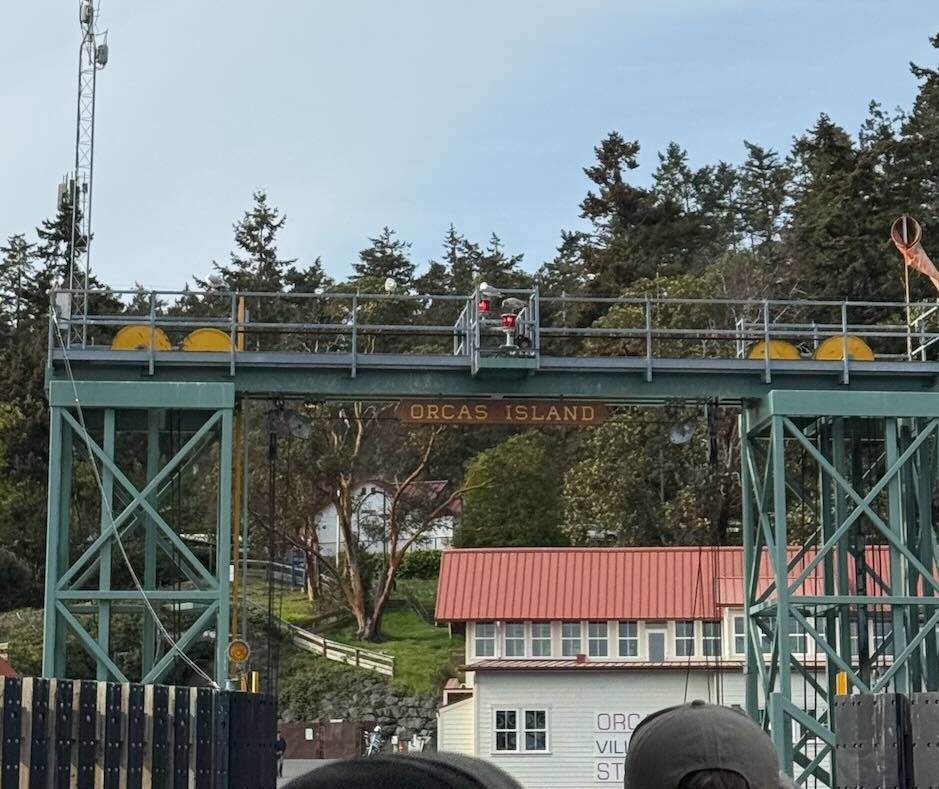

> This page compiles ***all*** daily posts for May 2026.

### 2026-05-01 — New Month, Same Mission
### Plan of the Week: April 27 - May 3, 2026

#### *High- level outline for the week. Adjusted daily to reflect progress of the day before*

-   This week is all about making progress in my writing deliverables.

------------------------------------------------------------------------

> ~~Monday - UW-RUA~~
>
> ~~Tuesday - Finishing my Annual Evals~~
>
> ~~Wednesday - Methylation & Biomarkers~~
>
> ~~Thursday - Methylation~~
>
> Friday - Methylation and Biomarkers
>
> Saturday - No Science
>
> Sunday - Methylation

------------------------------------------------------------------------

### Plan of the Day

### *Granular level task list to accomplish the high- level goal outlined above*

-   My primary goals for today are as follows:
    -   Get my NSF Activities Report submitted
    -   Work on biomarker visualizations
    -   Define May goals and strategy to complete them

### Projects Touched Today

-   Mussel Biomarkers

------------------------------------------------------------------------

### Progress Notes

-   The first thing I did was to complete my NSF activities report and
    send it to Steven to sign before I upload it.
-   An unexpected surprise came from PoE opening a call for pre-doc
    candidates to teach some of their courses as the Instructor of
    Record - I will be submitting my application before the May 18th
    deadline.
    -   I did reach out to a few folks to confirm I can use them as my
        references, and put the rest of the app on the task list for
        next week.
-   I had to shift to knocking out some UW-RUA tasks so I could focus on
    my own work for the rest of the day.
-   Moving over to biomarkers, my first step is to make a list of
    figures that support the main result and manuscript narrative, then
    I will review what I have and determine what I need before jumping
    in to create that.
    -   The main takeaway is that the spatial results of the
        contaminants are highly correlated, but the biomarkers are not;
        neither the normalized (to the reference) value nor the
        composite IBR score reflect a consistent significant correlation
        between the contaminant profiles and the biomarker response at
        the site nor the reporting area level.
    -   In addition, the contaminant profile at the reference site
        indicated a high SOD response that may be related to many
        factors outside of the contaminant profile.
-   While reviewing biomarkers, I had to break to meet with the TNC
    folks re: Yellow.
    -   We have to spend the balance of the funding before the end of
        the 2026 fiscal year, so since the quote left some room
        remaining for additional sequences, I'm going to head up to
        Yellow on Sunday to take eDNA samples and head home. Not ideal,
        but so be it.
        -   Because of the shift in plans, I had some restructuring of
            the remainder of Friday through Sunday to do's.
        -   I shifted my Saturday tasks to Friday, opening Saturday for
            work that was slated for Sunday/ Monday.
        -   I paused today's work to get through my personal obligations
            since I'm almost out of the woods and back on track with
            manageable daily workloads.

------------------------------------------------------------------------

### Outcomes: Products & Word Count

-   No tangible products

> **Today's total: 0 words**
>
> **Monthly total to date: 0 words**
>
> **Annual total to date: 41,162 words**
>
> **Annual target total to date: 58,500 words**

### Next Up: Tomorrow's Plan

-   Biomarker figures and result re-working.
-   Methylation results and discussion framing.

### 2026-05-02 - Saturday Sunshine will have to Wait!
### Plan of the Week: April 27 - May 3, 2026

#### *High- level outline for the week. Adjusted daily to reflect progress of the day before*

-   This week is all about making progress in my writing deliverables.

------------------------------------------------------------------------

> ~~Monday - UW-RUA~~
>
> ~~Tuesday - Finishing my Annual Evals~~
>
> ~~Wednesday - Methylation & Biomarkers~~
>
> ~~Thursday - Methylation~~
>
> ~~Friday - Methylation and Biomarkers~~
>
> Saturday - No Science
>
> Sunday - Methylation

------------------------------------------------------------------------

### Plan of the Day

### *Granular level task list to accomplish the high- level goal outlined above*

-   My primary goals for today are as follows:
    -   Work on biomarker visualizations and results
    -   Define May goals and strategy to complete them
    -   Methylation results and discussion points

### Projects Touched Today

-   Mussel Biomarkers
-   Yellow Island

------------------------------------------------------------------------

### Progress Notes

-   The first thing I did was to brain dump the tasks related to the
    mussel work - biomarkers and methylation.
    -   One of my goals for May is to get the biomarker manuscript out
        to my committee and WDFW
    -   Another May goal is to have a complete, semi-polished draft of
        the methylation work
    -   My last goal for May is to frame Chapters 3 & 4 for my proposal
        and build those with Steven as the other work progresses. The
        point here is logical, doable, chapters that build on the first
        two while (1) creating new knowledge with what we already have,
        and (2) validating that new knowledge.
    -   My point here, of veering toward my May goals, is to help me
        define my weekly and then daily tasks to complete what is in
        front of my while maximizing my efforts (in lit review
        especially) to keep my focus forward. This helps me not get
        stuck in trying to perfect what I cannot perfect alone.
    -   My non-science May goal is to share the crappy drafts, share the
        messy plan, share before I feel like I am ready. This has always
        been a problem for me, I want things to be the best I can make
        them before asking for feedback, but it has proven (repeatedly)
        to be an unnecessary time suck. I do not have the time to fork
        over - I need it to sit with the lit, the analysis results, the
        thoughts need room to breathe - they can't do that if I'm always
        trying to put a shine on \$h1+...
-   Back to Biomarkers.
    -   I am ignoring the exploratory plots for this exercise.
        -   The only ones that may illustrate the biomarker- only values
            and the IBR scores are the radars for the reference site and
            any other site for comparison.
        -   All others are designed with the supplementary information
            in mind.
    -   The main figures should illustrate where we worked, what we
        found, how what we found relates (or doesn't) contaminant
        concentrations and mussel response.
        -   Map of the sampling sites color coded by reporting area.
        -   A 2 panel plot that shows the site-level P450 values in one
            panel and the SOD values in the next. Color coded by
            reporting area, symbol size = activity level.
        -   A 3 panel box plot of the IBR scores, biomarkers only,
            morphometrics only, and then the combined. For a clean plot,
            it will have to be at reporting area level, maybe a
            site-level one can be in the supplement to show the
            intra-site variability.
        -   A 3 panel map of the contaminant class spatial analysis
            (likely PAH and PCB) next to the combined IBR scores. All
            color coded by reporting area with symbol size = magnitude

I think the plots below illustrate what I outlined above, noting that
polishing the viz will come during edits/ writing revisions.

{fig-align="left"
width="500"}

{fig-align="left"
width="500"}

{fig-align="left"
width="500"}

{fig-align="left"
width="400"}

{fig-align="left"
width="400"}

------------------------------------------------------------------------

### Outcomes: Products & Word Count

-   Biomarker visualization and justification & captions: 150 words
    -   5 plots, maps or tables produced

> **Today's total: 0 words**
>
> **Monthly total to date: 0 words**
>
> **Annual total to date: 41,162 words**
>
> **Annual target total to date: 59,000 words**

### Next Up: Tomorrow's Plan

-   Yellow eDNA sampling.
-   Map out bench work schedule to send to Cole for the DNA extractions
    and QC.

### 2026-05-03 - Hurry Up & Wait
### Plan of the Week: April 27 - May 3, 2026

#### *High- level outline for the week. Adjusted daily to reflect progress of the day before*

-   This week is all about making progress in my writing deliverables.

------------------------------------------------------------------------

> ~~Monday - UW-RUA~~
>
> ~~Tuesday - Finishing my Annual Evals~~
>
> ~~Wednesday - Methylation & Biomarkers~~
>
> ~~Thursday - Methylation~~
>
> ~~Friday - Methylation and Biomarkers~~
>
> ~~Saturday - No Science~~
>
> Sunday - Methylation

------------------------------------------------------------------------

### Plan of the Day

### *Granular level task list to accomplish the high- level goal outlined above*

-   My goal for today is to get these samples and beat traffic back.

### Projects Touched Today

-   Yellow Island

------------------------------------------------------------------------

### Progress Notes

-   Nothing like getting up at 4a to make a ferry that is now the
    catchall for the earlier ferries that were cancelled...
    -   Made it to Orcas Island, then Yellow to collect my samples
        before the low tide window closed.
    -   Something hilarious about being so short that even when you
        fully extend your arms you are not taller than the cyclists in
        front of you to get a better photo of landing!

{fig-align="left" width="400"}

### 2026-05-04 - Monday Catch-Up
### Plan of the Week: May 4 - May 10, 2026

#### *High- level outline for the week. Adjusted daily to reflect progress of the day before*

-   This week is all about getting biomarkers out!

------------------------------------------------------------------------

> Monday - Catching up & weekly planning
>
> Tuesday - Steven Working Session & UW-RUA
>
> Wednesday - Biomarkers & UG Bench Prep
>
> Thursday - Biomarkers & Bench Work
>
> Friday - Biomarkers & Bench
>
> Saturday - Biomarkers
>
> Sunday - Afternoon Methylation Work

------------------------------------------------------------------------

### Plan of the Day

### *Granular level task list to accomplish the high- level goal outlined above*

-   My goals for today are:
    -   Wrap-up my GSAR and Steven 1v1 Agenda for Tuesday
    -   Continue the methylation results and discussion framing
    -   Plan T-F with specific tasks

### Projects Touched Today

-   Mussel Methylation
-   Mussel Biomarkers

------------------------------------------------------------------------

### Progress Notes

-   Mondays are email/ task/ planning days
    -   I took a look at my upcoming deliverables, knocked out comms,
        and started building a plan for the week. My primary focus is on
        getting my mussel manuscripts out for review and editing.
    -   I also have a flurry of tasks for the last UW-RUA professional
        development programming event that takes place tomorrow.
-   I looked at what is on the agenda for tomorrow with Steven and
    started by knocking out my half of the GSAR. Not a morale booster,
    that's for sure.
    -   Turning to biomarkers - I added the notebook post with updated
        figures.
    -   I spent time writing out specific tasks to update the writing.
    -   Shifting to methylation, I took my handwritten notes and added a
        lose framing to both the results and discussion sections.
    -   I added the progress for 2026-27 AY funding options.
    -   Added the update on getting Cole into the lab.
-   I shifted over to knocking out UW-RUA tasks for tomorrow before
    meeting with Yen-Chu to discuss the PoE teaching positions at the
    end of the day.

------------------------------------------------------------------------

### Outcomes: Products & Word Count

-   Drafting methylation: 386 words

> **Today's total: 386 words**
>
> **Monthly total to date: 386 words**
>
> **Annual total to date: 41,548 words**
>
> **Annual target total to date: 60,000 words**

### Next Up: Tomorrow's Plan

-   Will be made during weekly set-up.

### 2026-05-05 - Meetings & Networking
### Plan of the Week: May 4 - May 10, 2026

#### *High- level outline for the week. Adjusted daily to reflect progress of the day before*

-   This week is all about getting biomarkers out!

------------------------------------------------------------------------

> ~~Monday - Catching up & weekly planning~~
>
> Tuesday - Steven Working Session & UW-RUA
>
> Wednesday - Biomarkers & UG Bench Prep
>
> Thursday - Biomarkers & Bench Work
>
> Friday - Biomarkers & Bench
>
> Saturday - Biomarkers
>
> Sunday - Afternoon Methylation Work

------------------------------------------------------------------------

### Plan of the Day

### *Granular level task list to accomplish the high- level goal outlined above*

-   My goals for today are:
    -   Meet with Steven
    -   Pull off the last UW-RUA event!

### Projects Touched Today

-   Mussel Methylation
-   Mussel Biomarkers

------------------------------------------------------------------------

### Progress Notes

-   Today is a meeting/ event heavy day.
    -   First up, my weekly 1v1 with Steven.
        -   Deliverables for next week include updates to both mussel
            manuscripts
    -   The remainder of the day was UW-RUA tasks and events.

------------------------------------------------------------------------

### Outcomes: Products & Word Count

-   No products

> **Today's total: 0 words**
>
> **Monthly total to date: 386 words**
>
> **Annual total to date: 41,548 words**
>
> **Annual target total to date: 60,500 words**

### Next Up: Tomorrow's Plan

-   Will be made in the AM.

### 2026-05-06 - On Wednesdays We Write in Pink
### Plan of the Week: May 4 - May 10, 2026

#### *High- level outline for the week. Adjusted daily to reflect progress of the day before*

-   This week is all about getting biomarkers out!

------------------------------------------------------------------------

> ~~Monday - Catching up & weekly planning~~
>
> ~~Tuesday - Steven Working Session & UW-RUA~~
>
> Wednesday - Biomarkers & UG Bench Prep
>
> Thursday - Biomarkers & Bench Work
>
> Friday - Biomarkers & Bench
>
> Saturday - Biomarkers
>
> Sunday - Afternoon Methylation Work

------------------------------------------------------------------------

### Plan of the Day

### *Granular level task list to accomplish the high- level goal outlined above*

-   My goals for today are:
    -   Wrap-up biomarkers results and discussion
    -   Clean up the biomarker manuscript folder to include in review
    -   Prep for UG bench support on Thursday

### Projects Touched Today

-   Mussel Biomarkers

------------------------------------------------------------------------

### Progress Notes

-   Today started with a daily planning session, prep for the handful of
    meetings I have, and outlining the biomarker results re-work.
    -   First up was task dumping and daily prep, today's working block
        will focus on re-working the results section of the biomarker
        paper by:
        -   Reorganizing the order results are delivered, spatial first,
            followed by biomarker activity and IBR scores.
    -   Next was lab meeting where we did a check-in and supported an
        undergrad in preparing for the presentation of their work.
-   I printed the draft visuals for the biomarker paper to help me keep
    the bigger picture in mind and ensure the narrative the viz tells is
    aligned with what I write.
-   I met with folks from Puget Sound Partnership to discuss an upcoming
    conservation event.
-   Turning back to biomarkers, I drafted a high level outline of topic
    sentences that match the results to the discussion.
    -   After re-reading what I have already written, I was able to
        re-work most of what was already there, by stripping it down to
        elementary- level sentences and removing any interpretation.
    -   Next I did the same with the discussion and then the last 3
        paragraphs of the introduction. The doc looks crazy, but it
        helps me see the narrative clearer.
-   I wrapped up the day by attending the professional development
    programming postmortem with the academic affairs team.

------------------------------------------------------------------------

### Outcomes: Products & Word Count

-   Drafting biomarker revisions: 431 words

> **Today's total: 431 words**
>
> **Monthly total to date: 817 words**
>
> **Annual total to date: 41,979 words**
>
> **Annual target total to date: 61,000 words**

### Next Up: Tomorrow's Plan

-   Continue biomarker work and prep for getting Cole setup in the lab.

### 2026-05-07 - Bench Work & Biomarkers
### Plan of the Week: May 4 - May 10, 2026

#### *High- level outline for the week. Adjusted daily to reflect progress of the day before*

- This week is all about getting biomarkers out!

------------------------------------------------------------------------

::: {}
> ~~Monday - Catching up & weekly planning~~
>
> ~~Tuesday - Steven Working Session & UW-RUA~~
>
> ~~Wednesday - Biomarkers & UG Bench Prep~~
>
> Thursday - Biomarkers & Bench Work
>
> Friday - Biomarkers & Bench
>
> Saturday - Biomarkers
>
> Sunday - Afternoon Methylation Work
:::

------------------------------------------------------------------------

### Plan of the Day

### *Granular level task list to accomplish the high- level goal outlined above*

- My goals for today are:
  - Continue with the biomarker re-work
  - Get Cole through lab 'onboarding' tasks

### Projects Touched Today

- Mussel Biomarkers

------------------------------------------------------------------------

### Progress Notes

- Today started with wrapping up some UW-RUA tasks and then moved into
  prep for the NWStraits fundraiser.
  - Met with Don and Mary Margaret to go over the plan for the cruise,
    and left with a few action items to prepare for the May 15th event.
- I transitioned to preparing the print materials for Cole that I
  gathered yesterday.
  - Protocols, lab safety forms, and skill inventory and schedule are
    ready to go for this afternoon.
- I finally took my notes for my [May
  goals](https://chrismantegna.github.io/labnotebook/weekly/2026_0502/)
  and added the steps to complete them noting the goal for Chapters 3 &
  4 will continue into June.
- I started my biomarker work block by reviewing what I completed
  yesterday, and chose to focus the first 45 minutes on creating the
  spatial analysis maps.
  - 

------------------------------------------------------------------------

### Outcomes: Products & Word Count

- Something: 0 words

::: {}
> **Today's total: 0 words**
>
> **Monthly total to date: 817 words**
>
> **Annual total to date: 41,979 words**
>
> **Annual target total to date: 61,500 words**
:::

### Next Up: Tomorrow's Plan

- Mussels x ∞.

### END
