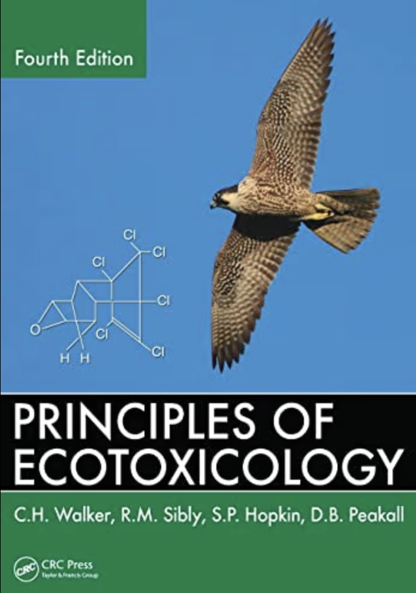

302

- I completed the FAQs document and grading for the annotated
  bibliography.

Exam Prep

- Alison and I met today to discuss and finish curating my reading list.
  - She will be writing questions re: aquatic toxicology and
    ecotoxicology.
  - Amongst the existing literature, we agreed on several chapters from
    the Principles of Ecotoxicology.

{fig-align="left" width="400"}

By the end of our meeting we determined that my knowledge should
address:

- Characteristics of PAHs, PCBs, and metals and their organism-impact
  profiles (not great wording for what are they, what do they do in a
  biological sense)

- Oxidative stress mechanisms and manifestations

- Biochemical responses including enzymatic activity and enzymatic
  effects

- Detoxification pathways, including how that scales through biological
  scales, whole organism, and population or ecosystem-levels

- Lab versus field based study mechanisms, limitations, anticipated
  outcomes, and what each can or cannot predict re: organismal response.
