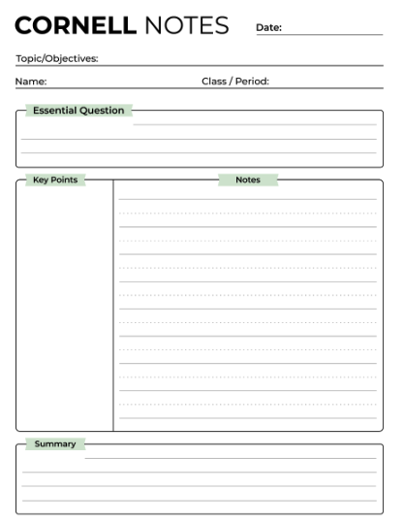

[← All foundational skills](index.qmd){.resource-back}

::: resource-intro
**The essential idea:** Notes are useful when they are structured and
preserve both what a source says and what *you* think about it. The
method you choose should follow from your purpose, and the real learning
happens when you return to your notes to recall, question, and connect.
:::

## Why notes matter

Notes do two jobs. Taking them helps you process material as you meet it
(the *encoding* function), and the finished notes become a record you
can study later (the *storage* function). Research on these two
functions has long found that taking notes **and reviewing them** beats
taking notes alone (Kiewra, 1989; Kiewra et al., 1991). In practice,
this means a page of notes you never revisit has done only half its
work.

It also means the most common student habits (rereading and
highlighting) are not enough by themselves. A large review of study
techniques rated rereading and highlighting as low-utility, and rated
self-testing and spacing study over time as high-utility (Dunlosky et
al., 2013). The methods on this page are built so that your notes become
a tool for self-testing and spaced review, not just a copy of the
source.

## Core process

These steps apply whatever you are reading, watching, or observing.

### 1. Name your purpose

Know why you are reading or observing. The purpose chooses the method.
Before you start, write one sentence at the top of the page:

> *I am reading this to…* understand the main concepts / evaluate the
> author's argument / critique the evidence / connect it to other
> sources / place it in a broader body of work.

### 2. Skim first, and write only questions

Skim the material once before you take any notes. ***Do not*** use this
pass to start your notes. Use it only to surface your own thoughts,
assumptions, and reactions. Ask three questions as you skim:

- What stands out?
- What is confusing?
- What sparks creativity or a connection to something I already know?

Skimming gives you a map of the material (headings, figures, main
claims) so that your real notes are selective instead of a transcript.
Outlining and highlighting also work better when done *after* you have
read a whole section rather than while reading it for the first time
(Miyatsu et al., 2018).

::: resource-intro2
**Capturing your thoughts:** Set up a "scratch" page before you skim.
Write your purpose at the top, then make two columns: one for
**conceptual** questions or thoughts and one for **practical**
questions.

- The **conceptual** column is for ideas about the broader topic, or
  places where the content connects to something else you know.
- The **practical** column is for questions that can be answered by the
  text itself or by a specific discipline practice (a definition, a
  method, a number, a procedure).

Practical questions send you back into the source. Conceptual questions
become the seeds of discussion, synthesis, and writing.
:::

### 3. Choose a method that fits the purpose

| Your purpose | Method | What it produces |
|----|----|----|
| Comprehension: understand and remember key ideas | **Cornell notes** | Cue questions, condensed notes, and a summary in your own words |
| Assess the author's point of view or argument | **Outlining** | The hierarchy of claims, sub-claims, and support |
| Critical assessment of a text | **Annotation** | Marked claims, evidence, assumptions, and limitations, tied to the original |
| Connect concepts or research | **Mind mapping** | A visual network of relationships |
| Broader context or synthesis across sources | **Synthesis matrix** | Comparable fields for many sources in one table |

If one method stops working partway through, that tells you something
about your purpose or the material. It is not a failure. Switch methods.

### 4. Return to your notes

Plan your first review within a day, then revisit at widening intervals.
Each time, try to **recall before you reread**: cover your notes, answer
your own cue questions, then check. Retrieving information from memory
produces better long-term retention than restudying it, even though
restudying *feels* more productive at the time (Roediger & Karpicke,
2006).

## Reading comprehension: Cornell notes

The Cornell system, developed by Walter Pauk at Cornell University, uses
the page layout itself as part of the process (Pauk & Owens, 2010).
Divide your page (paper or digital) into four sections at roughly the
proportions shown:

{fig-align="left" width="250"}

- **Header (top):** Course or project, date, source, and topic.
- **Cue column (left, about 2–2.5 in.):** Key terms, prompt questions,
  and study cues. Leave it blank while you record.
- **Notes column (right, about 6 in.):** Main ideas, paraphrased facts,
  and bullet points.
- **Summary (bottom, about 2 in.):** A one- to three-sentence wrap-up in
  your own words.

If you find you have more than three or four key concepts on one page,
reconsider whether Cornell notes fit your purpose. Either switch to
outlining, or skim again to find where concepts can be logically grouped
across several Cornell pages.

### The 5-R process

1.  **Record.** Take concise notes in the right column. Use short
    phrases and bullet points rather than long sentences. Standard
    abbreviations are fine (e.g., "w/," "→," "≈"), but don't invent new
    shorthand on the fly. You need to be able to read these notes weeks
    from now.
2.  **Reduce.** Soon after reading or class, reread your right-column
    notes and write keywords, concepts, or short quiz questions in the
    left column, each one lined up with the notes it points to.
3.  **Recite.** Cover the right column. Using only the cues on the left,
    explain the related content out loud from memory. Then uncover it
    and check. This is self-testing, one of the most reliable ways to
    strengthen memory (Dunlosky et al., 2013).
4.  **Reflect.** Think critically about the notes, the connections, and
    the terminology. How does this connect to what you already know?
    What would you challenge? Write your summary in the bottom section.
5.  **Review.** Return to your notes regularly, for example a short
    weekly review and again before exams or writing. Several brief
    reviews spaced over time work better than one long one.

*Further adaptations:* [NotesVista, "The 5 Rs of
Note-Taking"](https://notesvista.com/blog/the-5-rs-of-note-taking);
[Cornell Learning Strategies
Center](https://lsc.cornell.edu/notes.html).

## Argument and point of view: outlining

Outlining makes an author's structure visible: which claims are central,
which are supporting, and what evidence holds each one up.

- **Level 1, main topics:** Flush left. Primary themes, chapters, or
  major sections of the argument.
- **Level 2, subtopics:** Indented once. Secondary arguments or
  categories.
- **Level 3, supporting details:** Indented again. Specific facts,
  definitions, data, or statistics.
- **Level 4, examples:** Indented once more. Concrete examples, case
  studies, or proof.

Use Roman numerals, letters, numbers, or plain bullets, but be
consistent. Outline *after* reading a section rather than while reading
it. Until you know the content, it's hard to tell what is a main point
and what is a detail (Miyatsu et al., 2018).

**Check yourself:** Can you state the author's overall claim in one
sentence using only your Level 1 entries? If not, your outline may be
tracking topics rather than the argument.

## Critical assessment: annotation

Annotation keeps your thinking attached to the original text. It works
best when you will keep long-term access to that text. If you won't,
transfer your key annotations into separate notes.

### Core components

- **Marking the text:** Underline essential sentences, circle unfamiliar
  terms, and bracket central arguments. Mark selectively. Highlighting
  on its own does little for learning (Dunlosky et al., 2013).
- **Margin notes ("talking back"):** Write brief summaries, reactions,
  and critical questions in the margins or on sticky notes. Every mark
  should earn a margin note that says *why* you marked it.
- **A consistent symbol key:** For example `?` for confusing, `!` for
  surprising, `*` for main idea, `C` for claim, `E` for evidence, `A`
  for assumption, `L` for limitation. Write your key at the front of
  your notebook or file and use it every time.

### What to look for

Annotate the parts that matter for judging a source:

- **Claims.** What is the author asserting?
- **Evidence.** What supports each claim, and is it data, example,
  citation, or opinion?
- **Assumptions.** What must be true for the argument to work?
- **Limitations.** What does the author acknowledge, and what do they
  leave out?

### Best practices

- **Read in two passes.** Read a section quickly first to grasp its
  context, then go back to annotate.
- **Avoid over-marking.** If most of the page is highlighted, nothing
  stands out.
- **Tools:** For print, use pencil or ballpoint to avoid bleed-through,
  and pair any highlighting with handwritten notes. For digital texts,
  use the comment tools in your PDF reader or e-reader, or a
  collaborative platform such as [Hypothesis](https://web.hypothes.is/)
  or [Perusall](https://www.perusall.com/).

## Connecting concepts: mind mapping

Use a mind map when the relationships between ideas matter more than
their order.

1.  **Central topic:** Write and circle the main subject in the center.
2.  **Main branches:** Draw lines outward for major concepts or
    categories.
3.  **Sub-branches:** Add smaller branches for details, examples, or
    definitions.
4.  **Keywords:** Use short phrases (one to five words), not sentences.
5.  **Visuals and color:** Use colors, icons, and quick sketches to
    distinguish branches and aid memory.
6.  **Label the links:** Write a verb or phrase on connecting lines
    ("causes," "limits," "is measured by"). Labeled links turn a mind
    map into a *concept map*, which makes your understanding of each
    relationship explicit.

A meta-analysis of 55 studies found that building concept maps was
associated with better knowledge retention across many subjects, from
grade school to university (Nesbit & Adesope, 2006). Mind maps are well
suited to brainstorming, lecture review, essay planning, and studying
interconnected topics. Paper is often fastest, and apps such as
MindMeister or slide software work too.

## Synthesis: the matrix

When you are working across many sources, put your notes in a table with
the same columns for every source (question, methods, setting, findings,
limitations, relevance). One study found that matrix-style notes
produced better recall than conventional notes (Kiewra et al., 1991).
The matrix is also the bridge from note taking to writing. See
[Synthesizing Literature](literature-synthesis.qmd) for the full
process.

## Handwriting or typing?

You may have heard that handwriting is "proven" to beat typing. The
evidence is more mixed. An influential study found that laptop
note-takers transcribed more verbatim and did worse on conceptual
questions (Mueller & Oppenheimer, 2014), but later replications found
small or non-significant differences and concluded it is premature to
name a winner (Morehead et al., 2019; Urry et al., 2021).

What the research does support:

- **Process, don't transcribe.** Put ideas in your own words, whatever
  tool you use. Verbatim copying is the real risk, and typing makes it
  easier.
- **Manage distraction.** If you type, close other tabs and silence
  notifications.
- **Use the tool that fits the method.** Paper is often easier for
  Cornell layouts and mind maps. Digital tools make matrices, search,
  and linking to a reference manager easier.
- **Review either way.** The benefit comes from returning to your notes.

## A simple workflow

1.  Write a one-sentence purpose statement.
2.  Skim once, filling only your conceptual and practical question
    columns.
3.  Choose the method that matches your purpose.
4.  Read and take notes, recording source details as you go.
5.  Within 24 hours, reduce your notes to cues and recite from memory.
6.  Write a short summary in your own words.
7.  Schedule your next review.

## In context

::: callout-example
While reading about urban stream temperatures, a student's purpose is to
evaluate the study's argument. During the skim, they jot in the
practical column: *"How was temperature measured, and how often?"* In
the conceptual column: *"Would shaded and open-channel sites respond
differently?"* They outline the paper's claims, then answer the
practical question from the methods section. The conceptual question
goes on to guide their search for a second study.
:::

::: callout-example
A student in an introductory history course reads a primary source
letter for critical assessment. They annotate with a key (`C`, `E`, `A`,
`?`), and in the margins they note who wrote the letter, for whom, and
what the writer may have had reason to leave out. Their summary states
what the letter shows and what it cannot show.
:::

## Keep in mind

- **Keep three kinds of content visibly separate:** direct quotations
  (in quotation marks, with page numbers), paraphrases (with page
  numbers), and your own interpretations (marked, for example, with your
  initials or "ME:"). Mixing these is a common source of accidental
  plagiarism.
- **Record full source details as you work** (author, year, title, page
  or timestamp). A reference manager such as
  [Zotero](https://www.zotero.org/) can store these and link them to
  your notes.
- **Notes are drafts.** Messy is fine as long as you can still read them
  later.

## Sources and further reading

- Dunlosky, J., Rawson, K. A., Marsh, E. J., Nathan, M. J., &
  Willingham, D. T. (2013). Improving students' learning with effective
  learning techniques: Promising directions from cognitive and
  educational psychology. *Psychological Science in the Public Interest,
  14*(1), 4–58. <https://doi.org/10.1177/1529100612453266>
- Kiewra, K. A. (1989). A review of note-taking: The encoding–storage
  paradigm and beyond. *Educational Psychology Review, 1*, 147–172.
  <https://doi.org/10.1007/BF01326640>
- Kiewra, K. A., DuBois, N. F., Christian, D., McShane, A., Meyerhoffer,
  M., & Roskelley, D. (1991). Note-taking functions and techniques.
  *Journal of Educational Psychology, 83*(2), 240–245.
- Miyatsu, T., Nguyen, K., & McDaniel, M. A. (2018). Five popular study
  strategies: Their pitfalls and optimal implementations. *Perspectives
  on Psychological Science, 13*(3), 390–407.
  <https://doi.org/10.1177/1745691617710510>
- Morehead, K., Dunlosky, J., & Rawson, K. A. (2019). How much mightier
  is the pen than the keyboard for note-taking? A replication and
  extension of Mueller and Oppenheimer (2014). *Educational Psychology
  Review, 31*(3), 753–780. <https://doi.org/10.1007/s10648-019-09468-2>
- Mueller, P. A., & Oppenheimer, D. M. (2014). The pen is mightier than
  the keyboard: Advantages of longhand over laptop note taking.
  *Psychological Science, 25*(6), 1159–1168.
  <https://doi.org/10.1177/0956797614524581>
- Nesbit, J. C., & Adesope, O. O. (2006). Learning with concept and
  knowledge maps: A meta-analysis. *Review of Educational Research,
  76*(3), 413–448. <https://doi.org/10.3102/00346543076003413>
- Pauk, W., & Owens, R. J. Q. (2010). *How to study in college* (10th
  ed.). Cengage Learning.
- Roediger, H. L., & Karpicke, J. D. (2006). Test-enhanced learning:
  Taking memory tests improves long-term retention. *Psychological
  Science, 17*(3), 249–255.
  <https://doi.org/10.1111/j.1467-9280.2006.01693.x>
- Urry, H. L., et al. (2021). Don't ditch the laptop just yet: A direct
  replication of Mueller and Oppenheimer's (2014) Study 1 plus mini
  meta-analyses across similar studies. *Psychological Science, 32*(3),
  326–339. <https://doi.org/10.1177/0956797620965541>
- Learning Hub (New Zealand). *Note-taking.*
  <https://www.learninghub.ac.nz/study-skills/readings/note-taking/>

## Practice this skill

Find the corresponding self-guided activity in [Practicing the
Skills](practicing.qmd#note-taking).

::: resource-footer
[Browse all guides](index.qmd) · [Practice activities](practicing.qmd)
:::
