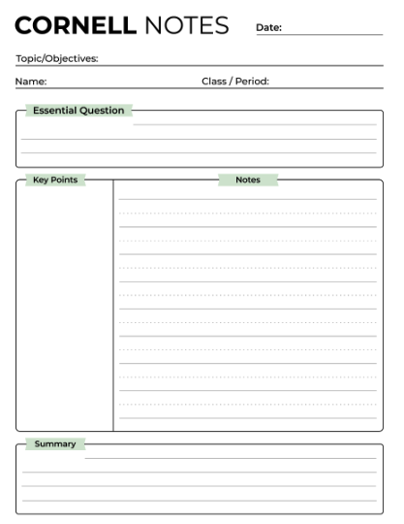

[← All foundational skills](index.qmd) {.resource-back}

::: resource-intro
**The essential idea:** Notes are useful when they are structured and
preserve both what a source says and what *you* think about it.
:::

## Core Process

Know why you are reading or observing. The purpose chooses the method.
It is important to clarify if you are reading for familiarity,
comprehension, assessment or critical review so you choose the right
note taking method.

The only steps that are universal are the following: skim the material
first and only write down what questions or thoughts come to mind. ***Do
Not*** use this read to start your notes, only to sort your own thoughts
or assumptions about the material. What stands out to you? What is
confusing? What sparks creativity or connection to the material? These
are the only questions to ask when skimming.

::: resource-intro2
**Capturing your thoughts:** When you're skimming, make two columns on
your page; one for conceptual questions or thoughts and another for
practical questions. The conceptual column is for your thoughts or ideas
about the broader topic. The practical column is for questions or
thoughts that can be answered in the text or specific discipline
practices.
:::

### Reading comprehension

Cornell-style notes to record key concepts and questions. This method's
layout (as seen below) is part of the process. Divide your page into
four sections at the approximate proportion of the page illustrated in
the image. This helps you do two major things: identify the key concepts
and summarize in your own words. If you find that you have more than 3-4
key concepts, you need to assess the application of this method for your
purpose - switch to outlining or skim again to determine where key
concepts can be logically grouped into several pages of this style of
note taking.

{fig-align="left" width="250"}

#### The 5-R Process for Comprehension (adapted from [NotesVista](https://notesvista.com/blog/the-5-rs-of-note-taking))

- Record- take concise notes, avoid long sentences but don't invent new
  shorthand or abbreviations, often notes are in a bullet point list

- Reduce- After your comprehension reading, reduce the likelihood of
  forgetting by going back and connecting the notes on the right hand
  side to key words, terminology, or concepts on the left.

- Recite- Review your notes by using the key concepts or terminology on
  the left to verbally recall what is related on the right (you should
  be covering the right side when you do this).

- Reflect- Think critically about the notes, connections and
  terminology. Then write a few sentence summary in your own words in
  the bottom section of your page.

- Review- Don't forget to return to your work! Regular repetition for
  short intervals of time is more effective for longer term recall.

### Read critically

Annotate claims, supporting evidence, assumptions, and limitations
instead of highlighting everything.

### Connect concepts

Use a mind map or comparison table when relationships across ideas
matter.

## A simple workflow

Start with a purpose statement. Skim once and write two kinds of
questions: practical questions you can answer by returning to the
material, and conceptual questions about implications or connections.
Select a method that addresses your purpose.

## In context

::: callout-example
While reading about urban stream temperatures, a student records the
study design and major result in a source-notes column, then separately
asks whether the result may differ between heavily shaded and
open-channel sites.
:::

## Keep in mind

Mark direct quotations, paraphrases, and your own interpretations
distinctly. Record source details and page numbers as you work.

## Practice this skill

Find the corresponding self-guided activity in [Practicing the
Skills](practicing.qmd#note-taking).

::: resource-footer
[Browse all guides](index.qmd) · [Practice activities](practicing.qmd)
:::
